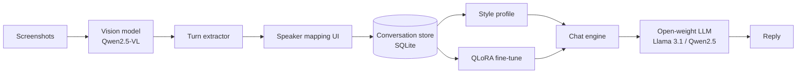

# Tumi

An open source website that reads old chat screenshots and lets you keep talking in the same style.

> পুরনো চ্যাটের স্ক্রিনশট থেকে তার লেখার ভঙ্গি শেখে, তারপর সেই ভঙ্গিতেই কথা বলে।

Everything runs on open-weight models. Your screenshots, your database, your machine.

**Status:** concept plus an early prototype. Screenshot ingest and prompt-only chat are the first milestone. Fine-tuning and model export come after.

## The idea

People keep years of conversations in screenshots. Tumi reads those screenshots, pulls out the message turns, and builds a style profile of the other person: how long their messages are, which emojis they use, whether they mix Bangla and English, how they open a conversation, what they call you.

You can then talk to an open-weight model that writes in that style. The model is not her, and the README is not going to pretend otherwise. It copies the texture of the writing, using only the screenshots you give it. Nothing is taken from her phone or her account.

## How it works

1. Upload screenshots of the conversation.
2. A vision model reads the bubbles and extracts speaker, text, and order.
3. You correct the speaker mapping once: which side is her, which side is you.
4. Tumi builds a style profile from the cleaned turns.
5. The chat engine combines the base model, the style profile, and an optional LoRA adapter trained on your data.



## What the model learns

- Message length and rhythm, including the habit of sending four short messages in a row.
- Emoji, sticker, and punctuation habits.
- Language mixing: romanized Bangla, English, slang, and the typos that show up repeatedly.
- Openers, nicknames, and running jokes that appear in the screenshots.
- When a reply is dry, when it is playful, and when it changes the subject.

What it cannot learn: memories that are not in the screenshots, tone of voice, or anything that happened outside the chat. It imitates a writing style. It does not reconstruct a person.

## Features

- Screenshot upload with multi-image batch support.
- Vision-based turn extraction with a manual correction step.
- Style profile you can read, edit, and version.
- Prompt-only chat that works on a laptop with no training.
- Optional QLoRA fine-tune with export to GGUF.
- Local-first storage. Uploads and the SQLite database stay on disk.
- Adapter export so the same profile runs on Ollama, llama.cpp, or vLLM.

## Stack

| Layer | Choice | Why |
| --- | --- | --- |
| Web app | Next.js (App Router), React, TypeScript | One codebase for UI and API routes |
| Styling | Tailwind CSS | Fast iteration on the chat and upload screens |
| Screenshot reading | Qwen2.5-VL 7B | Strong OCR on chat UIs, runs locally |
| Chat model | Llama 3.1 8B or Qwen2.5 7B | Small enough for a single consumer GPU |
| Fine-tuning | Unsloth + QLoRA | Trains an 8B adapter on 12 to 16 GB of VRAM |
| Inference | Ollama for dev, vLLM for serving | Same GGUF or safetensors weights |
| Memory search | bge-m3 embeddings | Multilingual, handles Bangla and English |
| Storage | SQLite + Drizzle ORM | No server to run, easy to back up or delete |

## Getting started

Requirements: Node 20+, pnpm, and Ollama. A GPU is optional for the prompt-only path and recommended for training.

```bash
git clone https://github.com/your-org/tumi.git
cd tumi
pnpm install
cp .env.example .env.local
ollama pull qwen2.5vl:7b
ollama pull llama3.1:8b
pnpm db:push
pnpm dev
```

Open `http://localhost:3000`, upload a few screenshots, and start a chat.

`.env.example`:

```env
DATABASE_URL=file:./data/tumi.db
OLLAMA_BASE_URL=http://localhost:11434
VISION_MODEL=qwen2.5vl:7b
CHAT_MODEL=llama3.1:8b
ADAPTER_PATH=models/tumi-lora
```

## Training your own adapter

The prompt-only path needs no training. Train an adapter when the style profile starts to feel flat.

```bash
python -m venv .venv
. .venv/bin/activate
pip install -r training/requirements.txt
python training/build_dataset.py --db data/tumi.db --out data/profile.jsonl
python training/train_qlora.py --config training/configs/tumi-8b.yaml
python training/export_gguf.py --adapter out/tumi-lora --out models/tumi.gguf
```

Point `ADAPTER_PATH` at the result and restart the app. The adapter is a small file, so you can keep several profiles side by side and switch between them.

## Project layout

```
tumi/
  app/                Next.js routes and pages
  components/         chat, upload, and speaker mapping UI
  lib/
    ingest/           screenshot parsing and turn extraction
    style/            style profile builder
    chat/             prompt assembly and model calls
  training/           dataset builder, QLoRA config, export scripts
  models/             local weights and adapters (gitignored)
  data/               SQLite database and uploads (gitignored)
```

## Roadmap

- [ ] Screenshot ingest and speaker correction
- [ ] Style profile viewer and editor
- [ ] Prompt-only chat against Ollama
- [ ] QLoRA training from the UI
- [ ] Adapter export to GGUF
- [ ] Memory search over old messages
- [ ] Voice notes with an open TTS model
- [ ] Multi-profile support for different people

## Privacy and consent

Tumi is built to stay private, and it only works if you use it with permission.

- Everything stays local by default. No upload leaves your machine unless you configure a remote server.
- Upload only conversations you have permission to use. Copying someone's messages to build a chatbot of them without their knowledge is not what this project is for.
- The AI is labeled as an AI inside the chat. Do not use it to contact, deceive, or impersonate the real person.
- Delete a profile from the settings page. It removes the uploads, the database rows, and the adapter.
- 18+ only. This is not a therapy tool and not a substitute for a real relationship.

## Model licenses

The code is MIT. The model weights keep their own licenses. Qwen2.5-VL is under the Qwen license, Llama 3.1 is under the Llama 3.1 Community License, and the adapter you train inherits the license of the base model. Check each model card before you redistribute weights or a trained adapter.

## Contributing

Issues and pull requests are welcome. Good first issues are tagged on the tracker. For anything that touches the training pipeline, open an issue first so the dataset format stays stable.

## License

MIT. See `LICENSE`.
